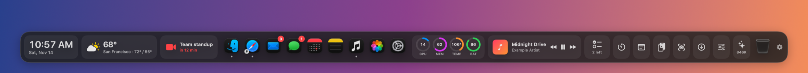

# WidgetDock



A second Dock for macOS with live widgets: clock, weather, next calendar event, apps and folders, system stats (CPU, memory, temperature, battery), now playing, todos and trash, plus small tools: focus timer, notes, clipboard history, screenshot, recent downloads, sound and display controls, and Claude Code token usage. It can replace the system Dock.

## Install

You need an Apple Silicon Mac (M1 or newer) running macOS 14 or later. There is no ready-made download, so you build it once on your own Mac. It takes about two minutes.

1. Open the **Terminal** app.
2. Install Apple's command line tools (skip this if you already have them). A window pops up; click Install and wait for it to finish.

   ```bash
   xcode-select --install
   ```

3. Download WidgetDock.

   ```bash
   git clone https://github.com/High-Shot/WidgetDock.git ~/WidgetDock
   ```

4. Build and install it.

   ```bash
   ~/WidgetDock/build.sh
   ```

The dock appears at the bottom of your screen and the app is now in your Applications folder.

## First run

- Click the **gear** at the right end of the dock to open Settings.
- Turn on **Replace the system Dock** to hide Apple's Dock, and **Start WidgetDock at login** to keep it after a restart.
- macOS will ask for permission the first time a feature needs it: Calendar (next event), Location (weather), Accessibility (badges and keeping windows above the dock), and Automation (music controls). Each one is optional.
- Drag an app from the Applications folder onto the dock to add it. Right-click an app to remove it or put it in a folder. Drag icons sideways to reorder them.

## Update

```bash
cd ~/WidgetDock && git pull && ./build.sh
```

macOS may ask for the permissions again after an update.

## Uninstall

Turn off **Replace the system Dock** in Settings, choose **Quit WidgetDock**, then delete WidgetDock from Applications.

## Notes

- Weather comes from open-meteo.com, using your location if you allow it.
- Calendar events come from the macOS Calendar app.
- Badges and "keep windows above the dock" need the Accessibility permission.
- Temperature uses private IOKit calls, so it may break on a future macOS.

## License

MIT. See [LICENSE](LICENSE).
